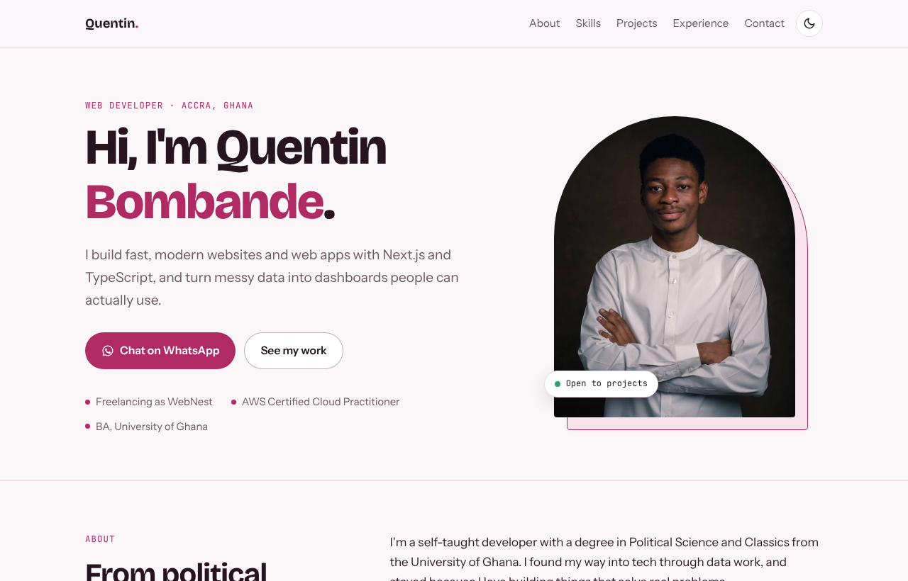

# Quentin Bombande · Portfolio

 

My personal portfolio: who I am, what I build, and how to reach me.

**Live site:** https://quentincoding912001.github.io/quentin-portfolio/



## Highlights

- Hand-built with semantic HTML and modern CSS, with no framework or build step
- Light and dark themes that follow the system setting, with a manual toggle that is remembered
- Responsive from phone to desktop, with a sticky nav that reflows on small screens
- Accessible: visible keyboard focus, labelled controls, reduced-motion support and good colour contrast
- Fast: one stylesheet, a resized portrait with fixed dimensions (no layout shift) and preconnected fonts
- Share-ready: Open Graph tags and a 1200x630 preview image for LinkedIn, WhatsApp and X
- Search-ready: canonical URL, sitemap and schema.org structured data for me and WebNest

## Run it locally

No build step is needed. Clone the repo and open `index.html`, or serve the folder:

```bash
git clone https://github.com/QuentinCoding912001/quentin-portfolio.git
cd quentin-portfolio
python -m http.server 8000   # then open http://localhost:8000
```

## Project structure

```
index.html      Page content and a small script for the theme toggle and copy button
style.css       Design tokens, layout and both themes
prof.jpg        Portrait
og-image.jpg    Link preview image
icon-180.png    Home-screen icon for iPhone and iPad
sitemap.xml     Sitemap for search engines
Quentin-Bombande-CV.pdf   CV for download
docs/           Screenshot used in this README
```

## Contact

quentin912001@gmail.com · [LinkedIn](https://www.linkedin.com/in/quentin-bombande-3b3965221/) · [GitHub](https://github.com/QuentinCoding912001)
